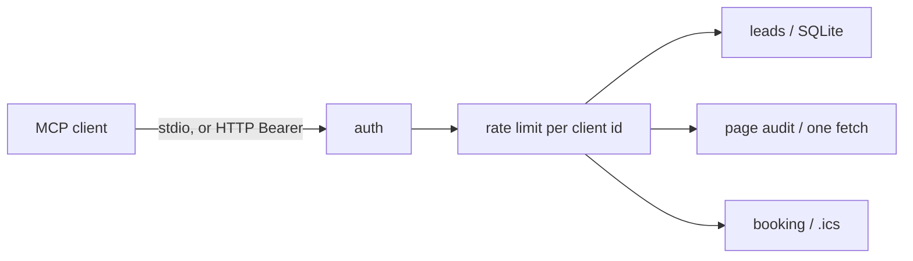

# mcp-server-suite

Three local MCP servers for a small business, in one repo. A lead list, a page audit, and booking slots from an `.ics` file. No account, no paid API, no network except the page audit fetching a URL you name.

They share one auth and rate-limit package. Each server checks a bearer (API key or a local HMAC token), counts calls per client, validates inputs, and returns errors as JSON.

## What it is

| Package | What it does |
|---|---|
| `@braylo/mcp-core` | API keys, HMAC bearers, fixed-window rate limit, stderr logs, structured tool errors |
| `@braylo/mcp-leads` | Leads in a SQLite file. Create, get, update, search, notes |
| `@braylo/mcp-page-audit` | Fetch one URL, or accept HTML, and return timings plus a fixed list of markup findings. No score |
| `@braylo/mcp-booking` | Read an `.ics` file and return busy time and open slots. A documented recurrence subset |

The packages are set up to publish (`package.json` name, `bin`, `files`, `engines`). They have not been published. `npx @braylo/mcp-leads` will not work until someone publishes them. Run the built `cli.js` files below.

This tree was not pushed to `github.com/braylo-ai/mcp-server-suite`. The environment here can push the current workspace only.

## Why

A small-business agent needs a few boring tools that stay on the machine: who asked about a quote, whether Thursday at 10 is free, and whether the homepage is missing a title. Those do not need a hosted CRM, a Lighthouse account, or a calendar vendor.

## Architecture



Stdio has no headers. The process is one client: the API key in its environment. HTTP checks `Authorization: Bearer` on every request with `requireBearerAuth` from `@modelcontextprotocol/server`. This server does not issue OAuth tokens and does not publish a discovery document. If a client can only get a token by doing an OAuth dance, point it at a real authorization server and put the resulting bearer in the key file, or use stdio.

## How auth and limits work

| Situation | Result |
|---|---|
| HTTP request with no or unknown bearer | `401` and `WWW-Authenticate: Bearer` |
| Failed HTTP auths from one address over the window (default 20) | `429` with `retry_after_ms` |
| Bearer without the `mcp` scope | `403` |
| Tool call without that tool's scope | tool error `forbidden`. The rate limit is not consumed |
| Tool call after `MCP_RATE_LIMIT` in the window (default 60 / 60s) | tool error `rate_limited` |
| stdio started with no key | process exits 1. Nothing is served |

The rate limit is a fixed window, not a sliding one. A client can use the full limit at the end of a window and the full limit again at the start of the next. State is in memory for this process. A restart clears it. It is not shared across processes.

`tools/list` and `initialize` are not counted. A call the SDK rejects for a bad shape is not counted, because the handler never runs. A call that enters the handler is counted, including business-rule errors such as a duplicate email.

Static API keys do not expire unless the key file sets `expiresAt` (unix seconds). The SDK rejects a token whose `expiresAt` is missing, so a static key is reported with an expiry 10 years out. That number is a sentinel, not a lifetime.

HMAC bearers are optional, for HTTP. Format: `v1.<base64url json>.<base64url hmac-sha256>`. The payload is `{ "v": 1, "sub", "scope", "iat", "exp" }`. They are not JWTs and there is no JWKS. Mint one with `MCP_BEARER_HMAC_SECRET=... npm run issue-token -- --client shop --ttl 3600`.

Logs are one JSON object per line on stderr. `authorization`, `token`, `password`, `secret`, and `Bearer …` strings are redacted. Tool arguments are not logged. stdout is the MCP stream when using stdio.

Tool failures look like this. `isError` is true. There is no fake success body.

```json
{"error":{"code":"rate_limited","message":"Rate limit exceeded for this client.","details":{"limit":60,"window_ms":60000,"retry_after_ms":1200}}}
```

Codes: `unauthorized`, `forbidden`, `rate_limited`, `invalid_input`, `not_found`, `conflict`, `payload_too_large`, `upstream`, `unsupported`, `internal`.

## Results

`npm run bench` writes [`results/bench.json`](results/bench.json). The run below is one process on the machine that produced that file (Node v22.23.4, linux 6.12.113+ x64, CPU reported as `Intel(R) Xeon(R) Processor`). Counts are checked by the script. Timings will move if you run it again. They are not a lab benchmark.

| Check | Result |
|---|---|
| Rate limit, limit 60 | calls 1–60 allowed, call 61 denied |
| 200,000 `take()` calls, one key, limit high enough that none were denied | 99.68 ns/check |
| 1,000 `LeadStore.create` calls, then a search for `lead500` | 586.967 ms to insert, 0.863 ms to search, 1 hit |
| `fixtures/page/north-wharf.html` (355 bytes) | findings `images_missing_alt`, `missing_canonical`, `missing_meta_description`, `thin_content` in 3.8 ms |
| Weekly Monday event across 2026, then a free Tuesday of 30-minute slots | 52 occurrences in 9.477 ms, 16 slots |

The lead timing is the normal create path (a lookup, an insert, and a `created` event), not a bulk import. The page-audit timing is HTML parsing only. The fetch timing is measured per call and is not in this table, because it depends on the URL.

## Tests

32 tests (`node --test`): auth (match, file vs shorthand, expiry, HMAC, stdio key rules), rate limit (exact cutoff, per client, window reset), log redaction, HTTP 401 / 429 / per-client tool limit, leads (create, duplicate email, search where `%` is literal, read-only scope, rate limit, stdio tool list, missing key exits 1), page audit (private addresses, fixture findings, a page with no findings, loopback blocked unless opted in, one real local fetch with a redirect, rate limit, stdio tool list), booking (DST conversion, weekly recurrence and EXDATE, busy hour, lunch gap, all-day block, 16 half-hour slots, a yearly rule refuses the file, a New York weekly meeting stays at 09:00 local, rate limit, missing file, stdio tool list).

```
$ npm test
ℹ tests 32
ℹ pass 32
ℹ fail 0
```

Node prints `ExperimentalWarning: SQLite is an experimental feature` while the leads tests run. The suite still passes. `node:sqlite` is marked experimental in Node 22.23.

## Run it

```bash
npm ci
npm test
npm run bench
```

Build is part of `npm test`. Each CLI:

```bash
export MCP_API_KEY="$(openssl rand -hex 32)"
node packages/leads/dist/cli.js
node packages/page-audit/dist/cli.js
MCP_BOOKING_ICS=fixtures/calendar/shop.ics node packages/booking/dist/cli.js
```

Add `--http --port 7481` (leads), `7482` (audit), or `7483` (booking) to listen on `127.0.0.1`. The MCP path is `POST /mcp`.

Per-server install snippets for Claude Desktop, Cursor, and Continue are in the package READMEs.

## Limits

- Stdio is one client per process. Two agents on one process share a rate-limit bucket.
- The comparison of an API key is constant-time for equal lengths. A different length returns false after a dummy compare, and the length still leaks. Use `openssl rand -hex 32`.
- Key lookup scans the file. It is meant for a handful of keys, not a user database. There is no password hashing.
- HMAC tokens are not OAuth. There is no refresh, no consent screen, and no protected-resource metadata.
- Rate-limit buckets and auth-failure buckets die with the process.
- Leads use Node's built-in SQLite, which warns that it is experimental. One writer is the expected use. The file is whatever `MCP_LEADS_DB` points at, or `data/leads.sqlite` under the current directory.
- Page audit timings are one sample from this process: time to headers, then time to a capped body. Not Chrome, not a field dataset, not a score. Thresholds are the constants in `packages/page-audit/src/rules.ts` (`title` 15–60 characters, description 50–160, under 50 visible words, HTML over 1_000_000 bytes, headers over 800 ms, total over 3000 ms).
- Page audit blocks loopback, private, link-local, CGNAT, multicast, reserved, and documentation addresses, plus a few metadata hostnames. The check runs in the DNS lookup `node:http` uses. A platform that connects to an address the lookup did not report can still get through. `MCP_AUDIT_ALLOW_PRIVATE=1` turns the check off, including for link-local metadata addresses. Redirects are followed at most 5 times, and each target is classified. TLS certificates are verified. Bodies are cut at 1_500_000 bytes. Decoding is UTF-8.
- Booking understands `VEVENT` with `DTSTART` / `DTEND` or `DURATION`, `VALUE=DATE`, UTC `Z`, floating times in `MCP_BOOKING_TZ` (default UTC), `TZID` when `Intl` knows the zone, `RRULE` `DAILY`, `WEEKLY` with `BYDAY`, `MONTHLY` with `BYMONTHDAY`, `INTERVAL`, `COUNT` or `UNTIL`, and `EXDATE`. Not yearly, not `BYSETPOS`, not `RDATE`, not a full calendar app. An unsupported event makes `list_events`, `busy_blocks`, and `find_slots` refuse, so a rule we cannot expand is not treated as free time. `describe_calendar` lists those events instead.
- `EXDATE` still consumes `COUNT`. A recurrence that lands in a DST spring-forward gap is skipped and does not consume `COUNT`.
- The walk is capped at 20,000 days. A `COUNT` series that starts further back than that, relative to the window, returns `unsupported` rather than a partial free/busy answer. Windows are capped at 366 days. `find_slots` returns at most 200 slots.
- Floating times and business hours use the configured IANA zone. Slot length is elapsed minutes. US and EU transitions are at night; a transition in the middle of a slot is not given a special case beyond skipping a wall time that does not exist.
- Logs can contain an error message from SQLite or the DNS resolver. They do not include tool arguments. The lead database itself stores names, emails, and notes in the clear.

## Stack

Node.js 22.13+ · TypeScript · `@modelcontextprotocol/server` 2.4 · `@modelcontextprotocol/client` 2.4 (tests) · `zod` 4 · `node-html-parser` · `node:sqlite` · `node:test`

## License

MIT
